# PresensiKu Enterprise — Commercial Monorepo

Sistem Manajemen Kehadiran & Audit Integritas Pegawai tingkat Enterprise yang dirancang untuk mencegah segala bentuk kecurangan absensi (*anti-fraud*). Dilengkapi dengan validasi **Geofencing GPS (Haversine Formula + Anti-Mock/Fake GPS)**, **Device ID Binding (Anti-Titip Absen)**, **Dynamic QR Code TOTP (HMAC-SHA256 Auto-Refresh 30 Detik)**, serta arsitektur backend ganda **Golang REST API & gRPC High Performance**.

---

## 📸 Tangkapan Layar Halaman Utama

Berikut adalah dokumentasi visual dari modul-modul inti yang telah diimplementasikan dalam PresensiKu Enterprise:

### 1. Dashboard Eksekutif & Statistik Disiplin
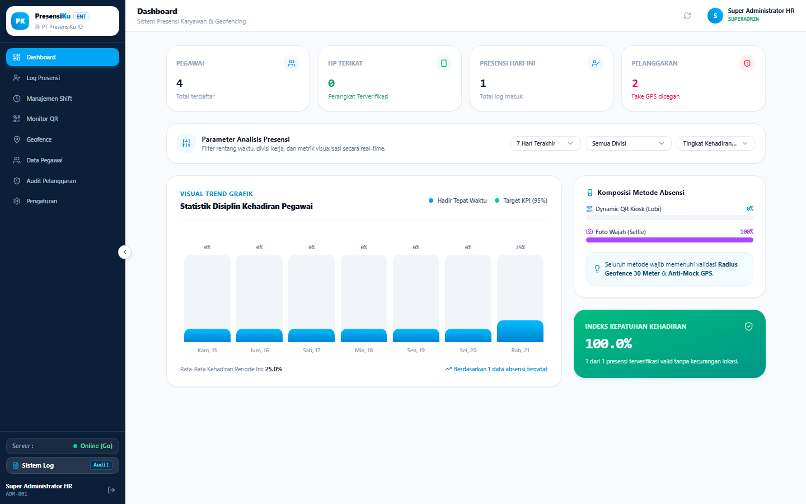
* **Penjelasan:** Menampilkan ringkasan KPI eksekutif secara real-time, meliputi total pegawai, perangkat terverifikasi (*Device Binding*), presensi harian, dan jumlah pelanggaran yang dicegah. Dilengkapi grafik visual trend kedisiplinan 7 hari terakhir, komposisi metode presensi, serta kalkulasi Indeks Kepatuhan Kehadiran yang dihitung secara dinamis dari database.

---

### 2. Log Presensi Pegawai & Audit Bukti Wajah
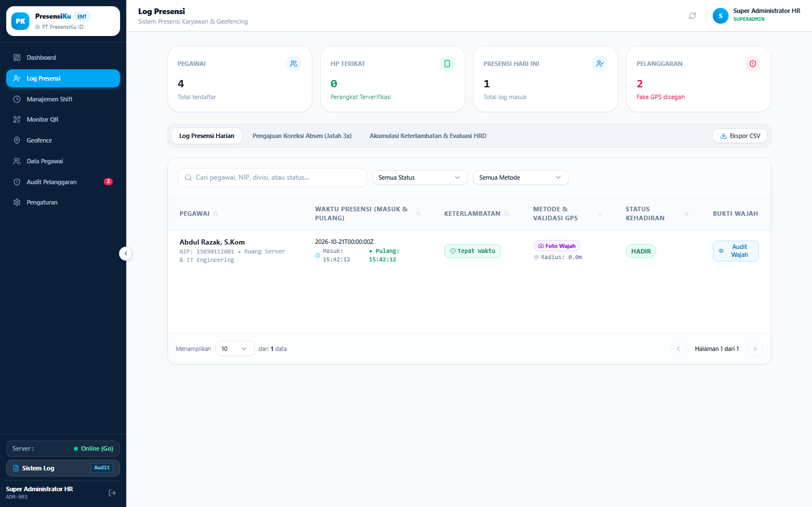
* **Penjelasan:** Rekam jejak kehadiran harian yang mendokumentasikan jam masuk dan jam pulang secara akurat. Admin dapat memantau status ketepatan waktu (*Tepat Waktu / Terlambat*), metode presensi yang digunakan (*Selfie / QR Kiosk*), radius jarak dari kantor saat absensi, serta melakukan audit keabsahan foto wajah pegawai untuk mencegah manipulasi.

---

### 3. Manajemen Shift Kerja & Batas Dispensasi
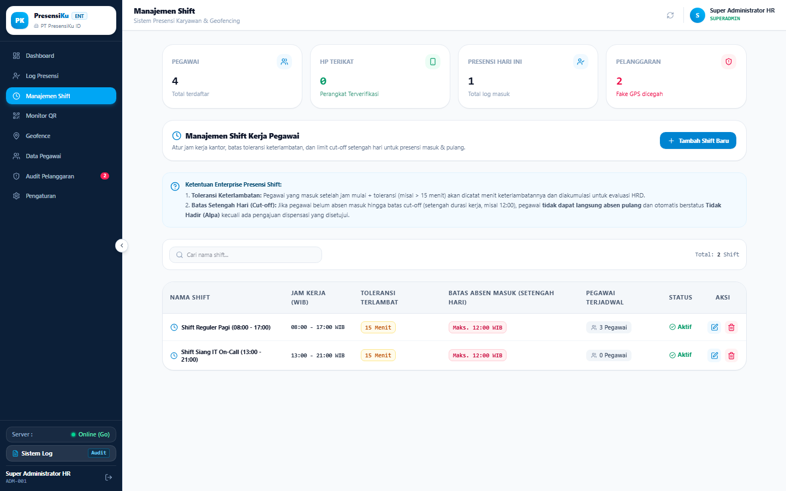
* **Penjelasan:** Modul pengaturan jam kerja fleksibel (Shift Reguler Pagi, Shift Siang, dsb.) dengan konfigurasi toleransi keterlambatan (misal 15 menit). Mengintegrasikan aturan *cut-off* setengah hari kerja (maksimal jam 12:00) di mana pegawai yang belum absen masuk tidak diperkenankan langsung absen pulang dan otomatis dinyatakan tidak hadir, kecuali mengajukan dispensasi khusus (kuota maksimal 3x).

---

### 4. Peta Geofence Radius Kantor Interaktif
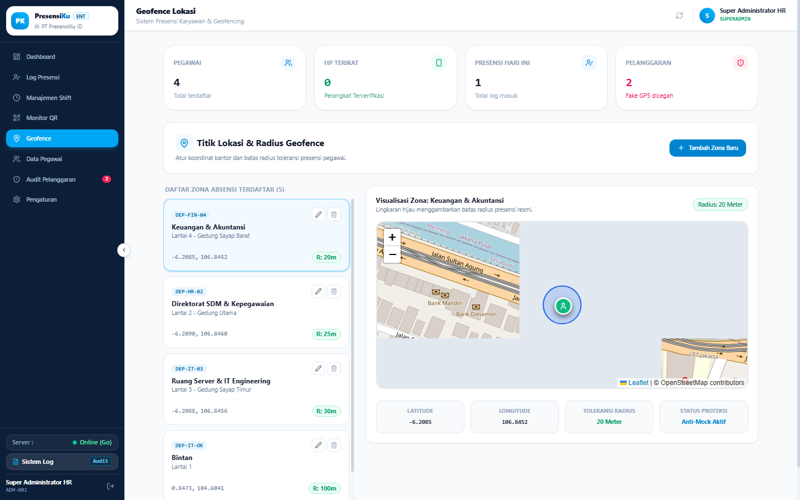
* **Penjelasan:** Visualisasi spasial interaktif menggunakan OpenStreetMap & Leaflet untuk menentukan titik koordinat presisi kantor beserta radius toleransi kehadiran (misal 20-30 meter). Dilengkapi pencarian nama lokasi/jalan otomatis dan indikator proteksi Anti-Mock GPS aktif.

---

### 5. Audit Integritas Keamanan & Anti-Fake GPS
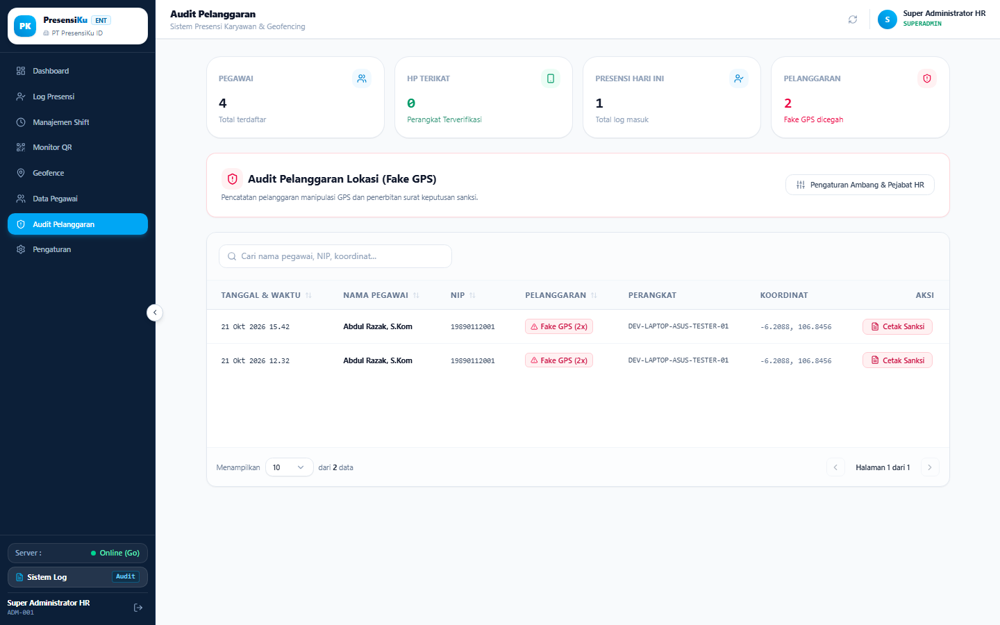
* **Penjelasan:** Pusat investigasi forensik terhadap indikasi kecurangan, seperti penggunaan aplikasi Fake GPS / Mock Location maupun ketidakcocokan identitas hardware (*Device ID*). Menyajikan data waktu kejadian, NIP, perangkat tersangka, koordinat asli, serta fitur cetak Surat Peringatan Pertama (SP-1) resmi dalam format dokumen PDF.

---

### 6. Monitor Kiosk Dynamic QR Code (Auto-Refresh 30 Detik)
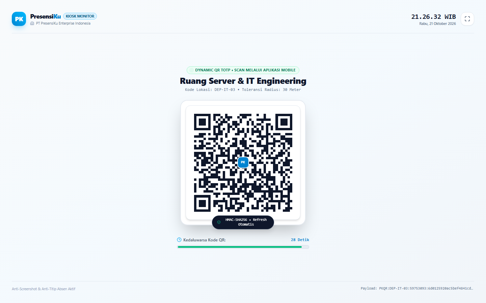
* **Penjelasan:** Mode layar penuh (*fullscreen kiosk*) untuk display tablet/monitor di lobi kantor. Menghasilkan QR Code terenkripsi berbasis HMAC-SHA256 TOTP yang otomatis berganti (*auto-refresh*) setiap 30 detik untuk menggagalkan upaya foto/screenshot QR code oleh pihak yang tidak bertanggung jawab.

---

## 📱 Tangkapan Layar Aplikasi Mobile Pegawai (Android Flutter)

Berikut adalah dokumentasi antarmuka aplikasi Android resmi pegawai (*native Flutter*) yang dioperasikan pada smartphone pegawai:

### 1. Autentikasi Pegawai & Device ID Hardware Binding
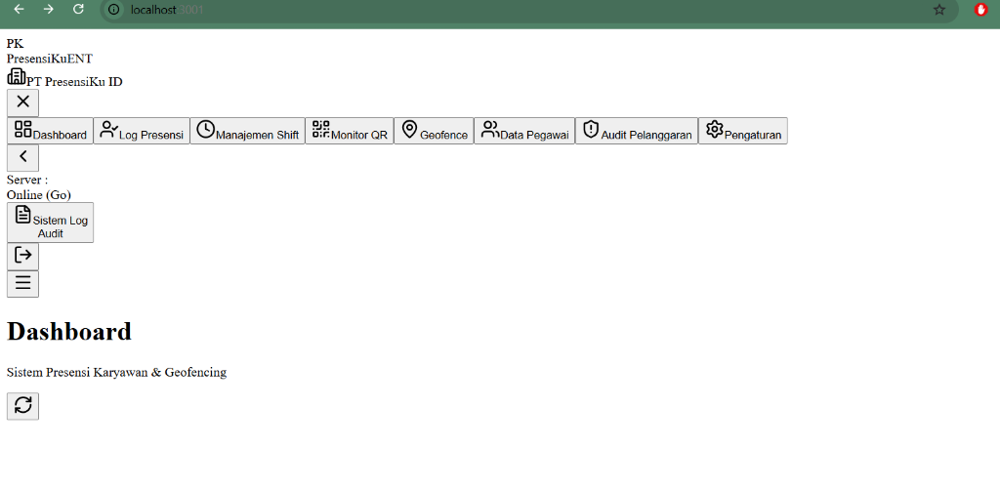
* **Penjelasan:** Layar login aman dengan NIP dan kata sandi. Saat pegawai pertama kali login, sistem secara otomatis mengikat (*binding*) identitas unik hardware smartphone (*Device ID / Fingerprint*) ke akun pegawai tersebut. Apabila pegawai mencoba login menggunakan perangkat ponsel lain tanpa izin HRD, sistem langsung menolak akses untuk mencegah praktik titip absen antar rekan kerja.

---

### 2. Beranda Utama Pegawai & Kartu Shift Dinamis
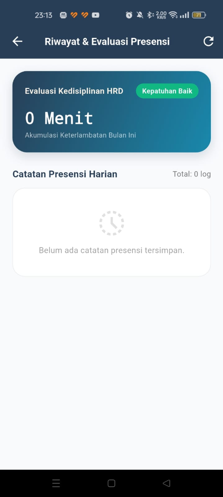
* **Penjelasan:** Pusat kendali harian pegawai yang menyajikan informasi shift aktif, batas jam masuk (*cut-off* 12:00 WIB), indikator status kehadiran (*Belum Masuk, Aktif Bekerja, atau Selesai Pulang*), serta tombol aksi langsung. Dilengkapi 8 menu cepat: Absen QR, Foto Selfie, Dispensasi, Riwayat Kehadiran, Informasi Geofence Radius, Jadwal Shift, Validasi Perangkat, dan Kontak Layanan HRD.

---

### 3. Pemindai Dynamic QR Kiosk & Toggle Mode Masuk / Pulang
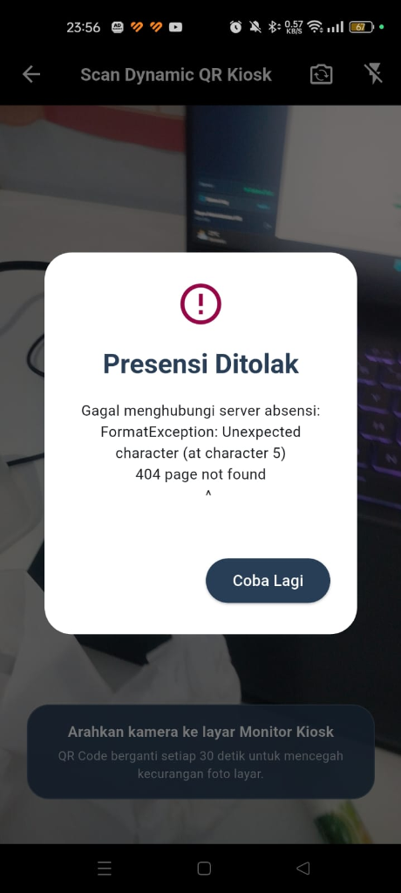
* **Penjelasan:** Antarmuka pemindai berkecepatan tinggi yang dilengkapi penyeleksi fleksibel `[ Absen Masuk ]` dan `[ Absen Pulang ]`. Sistem memeriksa validitas tanda tangan kriptografis HMAC-SHA256 TOTP dari QR Kiosk kantor sekaligus mengukur jarak radius pegawai secara real-time via satelit GPS.

---

### 4. Presensi Foto Wajah (Live Selfie) & Watermarking Cloudinary
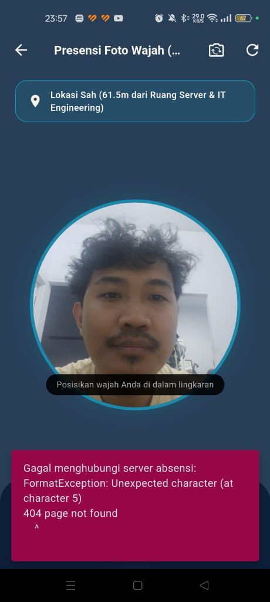
* **Penjelasan:** Modul presensi biometrik wajah pegawai dengan validasi liveness kamera depan. Gambar foto diproses dengan metadata watermark (Nama Pegawai, NIP, serta stempel waktu presisi) dan disimpan secara otomatis ke storage **Cloudinary CDN** untuk verifikasi forensik tim HRD. Terdapat sakelar mode untuk memilih Absen Masuk maupun Absen Pulang.

---

### 5. Formulir Pengajuan Dispensasi Keterlambatan / Izin
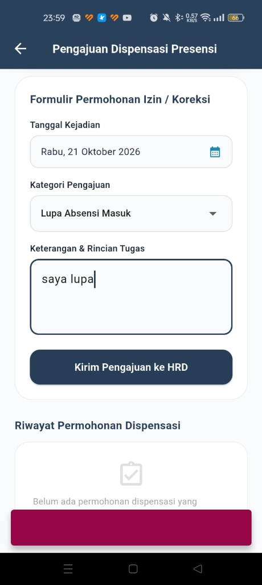
* **Penjelasan:** Layar permohonan izin resmi bagi pegawai yang datang terlambat melebihi batas cut-off setengah hari (jam 12:00) atau berhalangan hadir. Pegawai dapat memilih jenis izin (*Terlambat / Izin Resmi / Keperluan Mendesak*), mencantumkan alasan rinci, serta melihat sisa kuota dispensasi maksimal (3 kali per periode kerja).

---

### 6. Riwayat Presensi Harian & Audit Geotagging
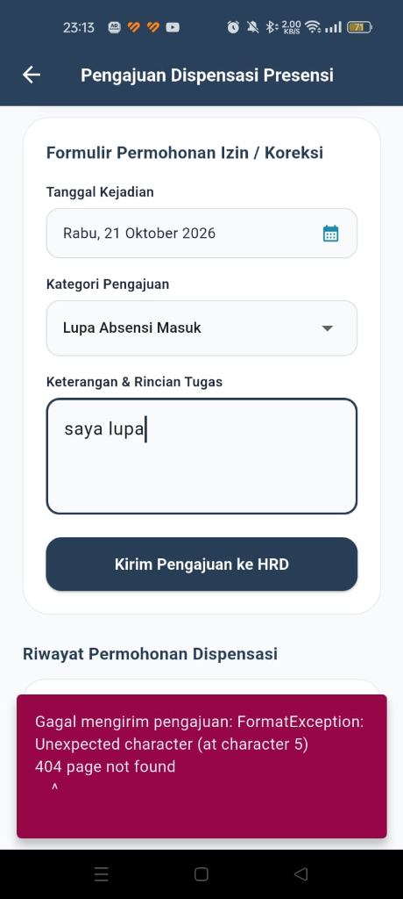
* **Penjelasan:** Daftar catatan kehadiran historis pegawai yang menampilkan jam masuk dan jam pulang, status ketepatan waktu (*Tepat Waktu / Terlambat*), jarak meter dari kantor, serta label lokasi penempatan kerja.

---

### 7. Profil Pegawai, Penempatan Kerja & Status Integritas Perangkat
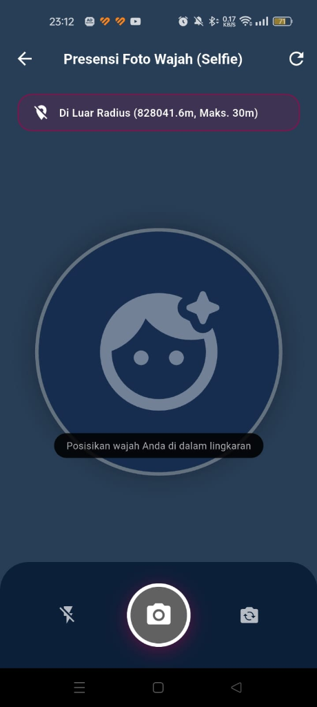
* **Penjelasan:** Menampilkan data identitas resmi pegawai, jabatan, unit/departemen kerja, nama kantor penempatan beserta koordinat latitude-longitude dan radius toleransi geofence (misal 100 meter). Halaman ini juga memperlihatkan status verifikasi Device ID yang terikat aktif pada database enterprise.

---

## 🛠️ Arsitektur & Teknologi

* **Backend Engine:** Golang (Gin Framework untuk REST API & Google gRPC Server pada port `50051`).
* **Frontend Web Admin:** Next.js 15 (React 19, TypeScript, Tailwind CSS, Lucide Icons, Leaflet).
* **Database & Persistence:** PostgreSQL / Neon Serverless Postgres.
* **Mobile Client:** Flutter Android (Haversine GPS calculation, Device ID hardware binding, dan Mock Location Detector).
* **Protokol Komunikasi:** REST HTTP JSON & Protocol Buffers (`proto/presensiku.proto`).

---

## 📁 Struktur Monorepo

```text
D:\presensiku-enterprise\
├── .github/
│   └── workflows/
│       └── build-flutter-apk.yml   # CI/CD otomatis build APK Flutter di GitHub Actions
├── android/                        # Aplikasi Mobile Pegawai (Flutter Android)
│   ├── pubspec.yaml
│   └── lib/
│       ├── main.dart
│       ├── core/                   # Konstanta API, Haversine & Anti-Mock GPS validator
│       ├── models/                 # Model Pegawai, Shift, Log Presensi
│       └── screens/                # Login, Scanner QR, Riwayat & Pengajuan Izin
├── backend/                        # Backend Server (Golang REST + gRPC)
│   ├── cmd/api/main.go             # Entry point REST (:8080) & gRPC (:50051)
│   ├── internal/
│   │   ├── config/                 # Konfigurasi ENV & Database
│   │   ├── grpcserver/             # Implementasi Layanan Presensi gRPC
│   │   ├── handlers/               # Controller REST (Auth, Presensi, Shift, Violations)
│   │   ├── middleware/             # Verifikasi JWT Token & RBAC
│   │   └── services/               # TOTP HMAC-SHA256 & Kalkulasi Jarak Haversine
│   ├── migrations/                 # Migrasi Skema SQL PostgreSQL
│   └── pkg/proto/                  # Generated gRPC code (Go)
├── frontend/                       # Dashboard Web Admin & Kiosk Display (Next.js 15)
│   ├── src/app/                    # App Router Next.js (:3001)
│   ├── src/components/             # Komponen UI Dashboard, Shift, Geofence, Modal
│   ├── src/lib/                    # Database client, API wrapper & gRPC bridge
│   └── proto/                      # Proto contract definitions
├── docs/
│   └── screenshots/                # Tangkapan layar dokumentasi resmi
├── docker-compose.yml              # Deployment kontainer terintegrasi
└── proto/
    └── presensiku.proto            # Definisi Protocol Buffers terpusat
```

---

## 🚀 Panduan Memulai Cepat

### 1. Salin Berkas Lingkungan (.env)
```bash
cp .env.example .env
cp backend/.env.example backend/.env
```
Isi variabel konfigurasi database PostgreSQL dan secret key sesuai environment Anda.

### 2. Jalankan Backend (Golang)
```bash
cd backend
go run cmd/api/main.go
# Server REST aktif di http://localhost:8080
# Server gRPC aktif di localhost:50051
```

### 3. Jalankan Web Admin (Next.js)
```bash
cd frontend
npm install
npm run dev
# Dashboard Web Admin aktif di http://localhost:3000 (atau :3001)
```

---

## 🔒 Standar Keamanan & Kepatuhan
1. **Anti-Mock GPS / Fake Location:** Deteksi tingkat kernel Android terhadap aplikasi penyedia lokasi tiruan.
2. **Device Hardware Binding:** 1 akun pegawai terkunci pada 1 identitas fisik smartphone.
3. **Rolling Token TOTP:** QR code diverifikasi secara kriptografis dan kedaluwarsa setiap 30 detik.
4. **Audit Trail Komprehensif:** Setiap tindakan modifikasi, persetujuan dispensasi, dan pembuatan sanksi dicatat pada sistem audit log.
